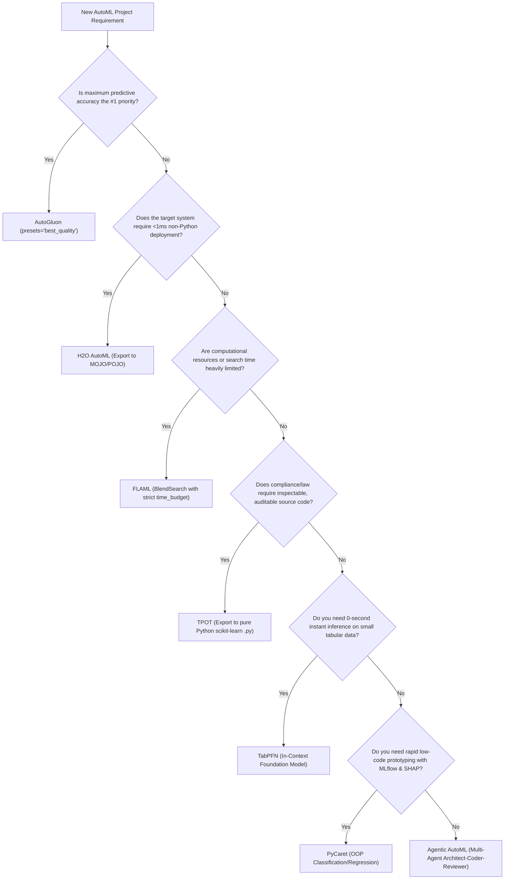

# Master AutoML Architecture & Project Integration Guide

> **Based on:** `Guide_Complet_Intégration_AutoML.pdf`  
> **Workspace Location:** `D:\EMSI\5emme\AUTOML\automl_projects\`

---

## 1. Executive Summary & Project Catalog

This directory contains **8 production-ready mini-projects** implementing every paradigm, library, and modern trend detailed in the AutoML Integration Guide:

| Project Folder | Technology / Framework | Paradigm | Key Differentiator | Manual Link |
|---|---|---|---|---|
| **`01_autogluon_project`** | **AutoGluon** (AWS) | Multi-layer Stacking & Ensembling | TabArena benchmark leader, deep ensembles | [Manual](file:///D:/EMSI/5emme/AUTOML/automl_projects/01_autogluon_project/MANUAL.md) |
| **`02_flaml_project`** | **FLAML** (Microsoft) | Budget Search (BlendSearch) | Resource-frugal, strict time budgets | [Manual](file:///D:/EMSI/5emme/AUTOML/automl_projects/02_flaml_project/MANUAL.md) |
| **`03_h2o_automl_project`** | **H2O AutoML** (H2O.ai) | Distributed In-Memory (JVM) | Ultra-fast MOJO binaries (< 1 ms latency) | [Manual](file:///D:/EMSI/5emme/AUTOML/automl_projects/03_h2o_automl_project/MANUAL.md) |
| **`04_pycaret_project`** | **PyCaret** | Low-Code OOP MLOps Wrapper | Rapid experimentation & MLflow pipelines | [Manual](file:///D:/EMSI/5emme/AUTOML/automl_projects/04_pycaret_project/MANUAL.md) |
| **`05_tpot_project`** | **TPOT** (DEAP) | Genetic Programming Trees | Generates clean, auditable Python `.py` code | [Manual](file:///D:/EMSI/5emme/AUTOML/automl_projects/05_tpot_project/MANUAL.md) |
| **`06_autosklearn_project`** | **Auto-sklearn** | Meta-Learning + Bayesian (SMAC3) | OpenML warm-start & Linux/Docker execution | [Manual](file:///D:/EMSI/5emme/AUTOML/automl_projects/06_autosklearn_project/MANUAL.md) |
| **`07_tabpfn_project`** | **TabPFN** | Tabular Foundation Model (In-Context) | 0-second training time (Forward pass only) | [Manual](file:///D:/EMSI/5emme/AUTOML/automl_projects/07_tabpfn_project/MANUAL.md) |
| **`08_agentic_automl_project`** | **Agentic AutoML** | Multi-Agent LLM Orchestration | Architect -> Coder -> Reviewer loop | [Manual](file:///D:/EMSI/5emme/AUTOML/automl_projects/08_agentic_automl_project/MANUAL.md) |

---

## 2. Production Deployment & Latency Matrix

| Framework | Serialization Format | Inference Latency | Non-Python Runtime? | Recommended Deployment Target |
|---|---|---|---|---|
| **H2O AutoML** | Binary MOJO / POJO | **< 1 ms** | **Yes** (Pure Java, C++, R, Scala) | High-frequency trading, banking microservices |
| **AutoGluon** | ONNX Graph / PyTorch | **1 - 5 ms** (ONNX) | **Yes** (C++, Go via ONNX Runtime) | Low-latency containerized C++/Go microservices |
| **TPOT** | Native Python script (`.py`) | **5 - 20 ms** | No (Standard `scikit-learn`) | Regulated industries requiring code auditing |
| **PyCaret** | Scikit-learn Pipeline (`.pkl`) | **10 - 50 ms** | No (Python required) | Standard Web APIs (FastAPI, Flask, Docker) |
| **FLAML** | Pickle / Joblib | **10 - 20 ms** | No (Python required) | Edge devices, resource-capped serverless |
| **Auto-sklearn** | Scikit-learn Pickle (`.pkl`) | **10 - 50 ms** | No (Linux Python required) | Batch offline processing, Linux environments |
| **TabPFN** | PyTorch Transformer Weights | **5 - 80 ms** | No (PyTorch / GPU runtime) | Small-batch zero-shot clinical/scientific APIs |
| **Agentic AutoML**| Validated Python Code (`.py`) | **5 - 20 ms** | Adaptable to target runtime | End-to-end self-healing enterprise ML |

---

## 3. Decision Tree: Choosing the Right AutoML Framework



---

## 4. Quickstart Execution Guide

To run any of the mini-projects, navigate into its directory and execute the runner script:

### Project 1: AutoGluon
```bash
cd D:\EMSI\5emme\AUTOML\automl_projects\01_autogluon_project
python dataset.py
python train.py
python predict.py
python export_onnx.py
```

### Project 2: FLAML
```bash
cd D:\EMSI\5emme\AUTOML\automl_projects\02_flaml_project
python dataset.py
python train.py
python predict.py
```

### Project 3: H2O AutoML
```bash
cd D:\EMSI\5emme\AUTOML\automl_projects\03_h2o_automl_project
python dataset.py
python train.py
python predict.py
python export_mojo.py
```

### Project 4: PyCaret
```bash
cd D:\EMSI\5emme\AUTOML\automl_projects\04_pycaret_project
python dataset.py
python train.py
python predict.py
```

### Project 5: TPOT
```bash
cd D:\EMSI\5emme\AUTOML\automl_projects\05_tpot_project
python dataset.py
python train.py
python predict.py
```

### Project 6: Auto-sklearn
```bash
cd D:\EMSI\5emme\AUTOML\automl_projects\06_autosklearn_project
# Native Linux / WSL:
python dataset.py
python train.py
python predict.py
# Or with Docker:
docker build -t autosklearn-project .
docker run --rm autosklearn-project
```

### Project 7: TabPFN
```bash
cd D:\EMSI\5emme\AUTOML\automl_projects\07_tabpfn_project
python dataset.py
python train_and_infer.py
```

### Project 8: Agentic AutoML
```bash
cd D:\EMSI\5emme\AUTOML\automl_projects\08_agentic_automl_project
python dataset.py
python run_agentic_pipeline.py
```

---

## 5. Official References & Documentation
- **AutoGluon**: [https://auto.gluon.ai/](https://auto.gluon.ai/)
- **FLAML**: [https://microsoft.github.io/FLAML/](https://microsoft.github.io/FLAML/)
- **H2O AutoML**: [https://docs.h2o.ai/h2o/latest-stable/h2o-docs/automl.html](https://docs.h2o.ai/h2o/latest-stable/h2o-docs/automl.html)
- **PyCaret**: [https://pycaret.org/](https://pycaret.org/)
- **TPOT**: [https://epistasislab.github.io/tpot/](https://epistasislab.github.io/tpot/)
- **Auto-sklearn**: [https://automl.github.io/auto-sklearn/](https://automl.github.io/auto-sklearn/)
- **TabPFN**: [https://github.com/automl/TabPFN](https://github.com/automl/TabPFN)
- **TabArena Benchmark**: [https://github.com/automl/TabArena](https://github.com/automl/TabArena)
