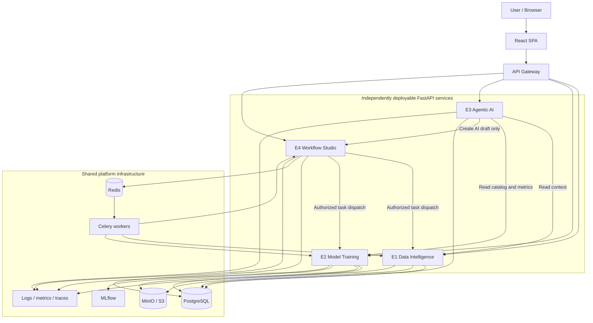

# AI Studio --- Backend Microservices Architecture Foundation

**Version:** 0.1.0
**Status:** Proposed foundation; team review required
**Audience:** Antigravity Architect agent and E1--E4 developers
**Decision:** Four independently maintainable FastAPI microservices
behind one API Gateway.

## 1. Instructions for the Architect agent

Before editing the repository:

1. Inspect the existing repository, frontend API clients, mock gateway,
   shared contracts, and current project structure.
2. Treat `FRONTEND_BACKEND_ARCHITECTURE.md` and the frontend's actual
   typed API clients as the source of truth for existing routes,
   payloads, response shapes, workflow node types, validation
   contracts, and SSE events.
3. Preserve the existing frontend and its behavior. Do not replace or
   redesign it.
4. Report discrepancies before resolving them; do not silently invent
   contract details.
5. Scaffold a small runnable foundation first: gateway, four
   independent FastAPI apps, health checks, shared contracts, and
   Docker Compose.
6. Implement typed endpoint stubs before complex business logic.
7. Keep each E service independently runnable, testable, versionable,
   and deployable.
8. Record new architectural decisions as proposals until the team
   approves them.

**Important update:** The original source document described one FastAPI
application with four routers. The updated team decision is a
microservices architecture: E1, E2, E3, and E4 are separate deployable
services behind an API Gateway. Preserve the original service
responsibilities and API contracts wherever possible.

## 2. Product objective and execution boundary

AI Studio transforms structured datasets and natural-language objectives
into validated, reproducible ML workflows. Initial scope: tabular
classification and regression. Broader DL modalities and arbitrary
plugin installation are future extensions unless explicitly approved.

- **E1 --- Data Intelligence:** authentication/project foundation
  (confirm ownership), datasets, profiling, EDA, preprocessing,
  splits.
- **E2 --- Model Training:** model catalogue, training, tuning,
  evaluation, experiments, registry records, inference.
- **E3 --- Agentic AI:** conversation, goal parsing, proposals,
  evidence-based explanations, modes, policy information, assistant
  audit.
- **E4 --- Workflow Studio & MLOps:** canonical workflows, versions,
  validation, approvals, execution orchestration, SSE, exports,
  promotions.

Non-negotiable boundary: - E3 proposes and explains. It MUST NOT launch
execution, dispatch training, or execute arbitrary code. - E3 may ask E4
to create an AI-origin draft workflow. - E4 is the only execution
authority and owns approval records and execution dispatch. - E1/E2
implement their domain operations; E4 orchestrates them but must not
duplicate their business logic. - The Gateway routes and applies
cross-cutting controls; it does not own domain logic or bypass service
authorization.

## 3. Target architecture



Each E service is a separate application and deployment unit. Docker
Compose is sufficient for the first demo; Kubernetes is not required.

### API Gateway responsibilities

- Single public backend entry point; browser must not call E1--E4
  directly.
- Route prefixes to their owning service.
- Validate/verify JWTs and propagate authenticated identity securely.
- CORS, upload limits, timeouts, rate limits, request/correlation IDs.
- Preserve HTTP methods, query strings, bodies, status codes and SSE
  streaming.
- Standardize gateway-level errors where appropriate.

The Gateway must not access service databases, implement domain rules,
create approvals, or trigger training. Gateway product (Traefik, Nginx,
or another option) is an open team decision. Choose one lightweight
option and document why.

## 4. Service ownership and API routes

### E1 --- Data Intelligence (`e1-data-service`, suggested port 8001)

Responsibilities: projects, dataset ingestion/versioning/preview,
profiling/EDA, data quality, preprocessing
catalogue/recommendations/validation/specifications/previews, data
splits, raw data storage.

Source routes: - `POST /auth/login`, `POST /auth/refresh` -
`GET|POST /projects` - `GET|POST /datasets` - `GET /datasets/{id}` -
`GET /datasets/{id}/preview` - `POST|GET /datasets/{id}/profile` -
`GET /preprocessing/catalog` - `POST /preprocessing/recommendations` -
`POST /preprocessing/validate` - `POST|GET /preprocessing/specs` -
`POST /preprocessing/specs/{spec_id}/preview` - `POST|GET /splits` -
`GET /splits/{id}`

Authentication is assigned to E1 in the source architecture, but the
team must confirm this ownership before implementation. E1 must help
prevent leakage: fit transformations only on training folds and do not
use target information improperly.

### E2 --- Model Training & Evaluation (`e2-training-service`, suggested port 8002)

Responsibilities: compatible model catalogue, hyperparameter
schemas/defaults, resource checks, training jobs, Optuna studies, model
training/evaluation, experiment metadata/metrics/curves, MLflow
integration, model artifacts, registry details, inference.

Source routes: - `GET /models/catalog` - `GET /training/resources` -
`POST /training/validate` - `GET /training/jobs`,
`GET /training/jobs/{id}` - `GET /tuning/studies/{id}` -
`GET /experiments`, `GET /experiments/{id}` -
`POST /experiments/compare` - `GET /models/registry`,
`GET /models/registry/{id}` - `POST /inference/predict`

E2 must not independently start a workflow because a browser request
reached it. E4 dispatches authorized work.

### E3 --- Agentic AI Assistant (`e3-assistant-service`, suggested port 8003)

Responsibilities: conversation history, natural-language goal parsing
into `GoalSpec`, clarification questions, read-only E1/E2 context
retrieval, structured `PlanProposal`, AI-origin draft creation through
E4, evidence-grounded explanations, project modes (`auto`, `guided`,
`expert`), policy matrix exposure, assistant audit, provider-independent
`LLMClient`, structured-output validation, optional RAG.

Source routes: - `GET|POST /assistant/messages` -
`POST /assistant/goals/parse` - `POST /assistant/proposals` -
`GET /assistant/proposals/{id}` - `POST /assistant/explanations` -
`GET|PUT /assistant/mode` - `GET /assistant/audit` -
`GET /policy/matrix`

E3 MUST NOT call `/executions`, dispatch Celery jobs, train models, or
create approvals on behalf of the user. It can explain required
approvals; E4 validates and records them. Start with one orchestrator
and typed tools, not multiple autonomous agents unless tests justify
them.

Suggested internal structure:

```text
e3_assistant/
  api/
  application/       # goal_parser, proposal_service, explanation_service
  llm/               # client, providers, prompts
  tools/             # data, model-catalog, workflow-draft tools
  retrieval/
  policy/
  schemas/
  tests/
```

### E4 --- Workflow Studio & MLOps (`e4-studio-service`, suggested port 8004)

Responsibilities: canonical DAG, node/template catalogue, immutable
workflow versions, semantic diffs, SHA-256 hashes, validation V1--V10,
approvals/scopes/budgets/revocation, sole execution endpoint, DAG/Celery
orchestration, node/execution state, SSE, cancellation, reproducible
exports, model promotions.

Source routes: - `GET /catalog/node-types`, `GET /catalog/templates` -
`GET|POST /workflows`, `POST /workflows/from-template` -
`GET /workflows/{id}` - `GET /workflows/{wf}/versions/{v}` -
`POST /workflows/{id}/versions` -
`GET /workflows/{wf}/versions/{v}/diff` -
`POST /workflows/{wf}/versions/{v}/validate` -
`GET /workflows/{wf}/versions/{v}/validation` - `GET|POST /approvals`,
`POST /approvals/{id}/revoke` - `POST /executions` (**only route that
starts execution**) - `GET /executions`, `GET /executions/{id}` -
`POST /executions/{id}/cancel` - `GET /executions/{id}/events` (SSE) -
`POST /exports`, `GET /exports/{id}` - `POST /registry/promotions`,
`GET /registry/promotions`

Canonical node types from source:

  Node type           Owner     Class Purpose

---

  `data.dataset`      E1           L0 Dataset version source
  `data.split`        E1           L1 Train/validation/test split
  `data.preprocess`   E1           L1 Preprocessing spec
  `train.model`       E2           L2 Train model
  `train.tune`        E2           L2 Optuna tuning
  `eval.compare`      E2           L0 Compare runs
  `eval.final_test`   E2           L3 Final unbiased test
  `model.register`    E2           L2 Register model

E4 dispatches typed work to E1/E2. The domain code stays with its owner.

## 5. Gateway route map

---

  Public prefix                       Upstream

---

  `/auth/*`, `/projects/*`,           E1
  `/datasets/*`, `/preprocessing/*`,
  `/splits/*`

  `/models/*`, `/training/*`,         E2
  `/tuning/*`, `/experiments/*`,
  `/inference/*`

  `/assistant/*`, `/policy/*`         E3

`/catalog/*`, `/workflows/*`,       E4
  `/executions/*`, `/approvals/*`,
  `/exports/*`, `/registry/*`
---------

Suggested local addresses:

```text
Browser -> http://localhost:8080
Gateway -> e1-data-service:8001
Gateway -> e2-training-service:8002
Gateway -> e3-assistant-service:8003
Gateway -> e4-studio-service:8004
```

Keep service ports internal by default. Expose them locally only when
useful for debugging.

## 6. Service-to-service communication

Use synchronous internal HTTP for immediate reads/commands: - E3 reads
E1 profiles and E2 catalogue/metrics. - E3 asks E4 to create an
AI-origin draft. - E4 dispatches authorized domain operations to E1/E2.

Use Redis/Celery for long-running tasks: - E1 imports/profiles data and
performs expensive data tasks. - E2 trains/tunes/evaluates models. - E4
coordinates DAG execution and export orchestration.

Proposed internal task envelope (new contract; team approval required):

```json
{
  "task_id": "task_x",
  "execution_id": "exec_x",
  "workflow_id": "wf_x",
  "workflow_version_id": "wfv_x",
  "node_id": "node_x",
  "project_id": "project_x",
  "actor_id": "user_x",
  "correlation_id": "corr_x",
  "operation": "typed.operation.name",
  "input_refs": {},
  "config": {}
}
```

Never put dataset contents or model binaries in Redis messages. Store
artifacts in MinIO/S3 and pass references.

## 7. Data ownership

Use one PostgreSQL server for local development, with separate databases
or schemas and credentials per service. Each service owns its tables and
migrations. No unrestricted cross-service database writes and no shared
ORM models.

---

  Domain                  Owner                   Storage

---

  Users/auth (confirm)    E1                      PostgreSQL
  and projects

  Dataset metadata,       E1                      PostgreSQL
  versions, profiles,
  splits, preprocessing
  specs

  Raw datasets and data   E1                      MinIO/S3
  artifacts

  Model catalogue, jobs,  E2                      PostgreSQL
  experiments, metrics
  metadata

  Model                   E2                      MinIO/S3 + MLflow
  binaries/artifacts                              references

  Conversations, goals,   E3                      PostgreSQL
  proposals, assistant
  audit

  Workflows, versions,    E4                      PostgreSQL
  validation, approvals,
  executions

  Export bundles          E4                      MinIO/S3

Promotion records       E4                      PostgreSQL
----------------------------------------------------------

Services read other domains through APIs/events, not direct database
access.

## 8. Shared contracts and API behavior

The frontend already uses typed API clients, JSON Schema contracts, and
selective mocks. Preserve them.

Proposed contract layout:

```text
packages/contracts/
  openapi/
    e1-data.openapi.yaml
    e2-training.openapi.yaml
    e3-assistant.openapi.yaml
    e4-studio.openapi.yaml
  schemas/
    common/ data/ training/ assistant/ workflow/ governance/
  examples/
```

Rules: - Every public endpoint has typed request/response schemas. -
Each service publishes OpenAPI. - Pydantic schemas must align with
shared JSON Schema. - Do not import another service's internal Python
modules. - Version contracts; prefer additive optional fields. -
Breaking changes require coordinated versioning/migration. - Add
contract tests against frontend API clients. - Do not silently change
payloads to satisfy one UI screen.

Preserve the common error shape:

```json
{
  "code": "VALIDATION_FAILED",
  "message": "Human-readable error explanation",
  "details": {"field": "additional_context"},
  "request_id": "req_abc123"
}
```

### Authentication

The source frontend uses `Authorization: Bearer <access_token>`. Gateway
validation/identity propagation and service-side project/operation
authorization are both required. Never trust arbitrary client-supplied
identity headers. Use secure signed internal identity context or service
credentials; exact mechanism requires team agreement. Never log secrets
or tokens.

## 9. Workflow hashing, validation, approvals

Preserve source hashing rules: - SHA-256, formatted
`sha256:<lowercase_hex>`. - Sort dictionary keys lexicographically
before serialization. - Exclude visual-only UI metadata (coordinates,
comments, visual labels). - Moving a node on canvas must not change
semantic hash. - Apply to `WorkflowVersion`, `PreprocessSpec`, and
`ExportManifest`.

The source defines validation layers V1--V10. Read their actual
definitions from existing `packages/contracts`; do not invent or rename
them. E4 coordinates full validation; E1/E2 perform domain-specific
checks.

Governance: - Workflow versions are immutable. - Approvals bind to a
specific version/content hash and declared scope. - Semantic edits
create a new version and require applicable revalidation/reapproval. -
Approvals can be revoked. - E4 checks scope, operation classes, budgets,
actor and version before dispatch. - Only E4 `POST /executions` triggers
execution. - L3 approval is required for model promotion to
staging/production. - L3 approval reference is required for exports with
`include_data = true`. - Preserve the exact L0--L3 policy matrix in
shared contracts; do not create a competing matrix.

## 10. SSE and execution events

E4 owns `GET /executions/{execution_id}/events`. Preserve source events:

```text
event: node_status
data: {"id":1,"type":"node_status","execution_id":"exec_1","node_id":"split_node","status":"running","ts":"2026-11-10T12:00:00Z"}
```

```text
event: execution_status
data: {"id":2,"type":"execution_status","execution_id":"exec_1","status":"succeeded","ts":"2026-11-10T12:01:00Z"}
```

Support `Last-Event-ID` reconnection. `NodeRun` includes progress 0--1,
`started_at`, and `finished_at`. Workers report status to E4 using a
documented internal mechanism. Gateway must not buffer SSE.

## 11. Suggested monorepo layout

```text
ai-studio/
  apps/web/                       # Existing frontend; preserve
  services/
    api-gateway/
    e1-data-service/
    e2-training-service/
    e3-assistant-service/
    e4-studio-service/
  packages/contracts/
  infra/
    gateway/
    postgres/
    minio/
    redis/
    mlflow/
  docs/
    architecture/
    api/
    decisions/
  docker-compose.yml
  .env.example
  README.md
```

Each service should contain its own `app/`, `migrations/`, `tests/`,
`Dockerfile`, and `README.md`. A suggested service layering is `api/`,
`domain/`, `application/`, `infrastructure/`, and `schemas/`.

## 12. Local development configuration

Suggested ports:

  Component                                       Port

---

  Existing Vite frontend                          5173
  API Gateway                                     8080
  E1 / E2 / E3 / E4          8001 / 8002 / 8003 / 8004
  PostgreSQL                                      5432
  Redis                                           6379
  MinIO API / Console                      9000 / 9001
  MLflow                                          5000

Frontend `.env`:

```env
VITE_API_BASE_URL=http://localhost:8080
```

Keep `VITE_MOCK_MODULES` working so a collaborator can connect one real
service while other modules remain mocked.

Example `.env.example` (placeholders only):

```env
GATEWAY_PORT=8080
FRONTEND_ORIGINS=http://localhost:5173
POSTGRES_HOST=postgres
POSTGRES_PORT=5432
E1_DATABASE_URL=
E2_DATABASE_URL=
E3_DATABASE_URL=
E4_DATABASE_URL=
REDIS_URL=redis://redis:6379/0
MINIO_ENDPOINT=minio:9000
MINIO_ACCESS_KEY=change_me
MINIO_SECRET_KEY=change_me
MLFLOW_TRACKING_URI=http://mlflow:5000
LLM_PROVIDER=ollama
OLLAMA_BASE_URL=http://host.docker.internal:11434
LLM_MODEL=
LLM_API_KEY=
JWT_SECRET=replace_with_a_long_random_secret
```

Never commit real `.env`, keys, passwords, JWT secrets, datasets, or
model artifacts.

## 13. Health, observability, and security

Proposed infrastructure endpoints for every service: -
`GET /health/live` - `GET /health/ready`

Gateway may expose aggregate health. Do not leak secrets or internal
topology in health responses.

Propagate `request_id`, `correlation_id`, `project_id`, `actor_id` where
relevant. Use structured logs. Never log passwords, bearer tokens, API
keys, sensitive dataset rows, or private prompts.

Security baseline: - Validate JWT and project ownership. - Enforce
authorization inside owning service, not only Gateway. - Restrict upload
size/types; generate object keys; keep data out of public web roots. -
Validate workflow schemas and node connections. - Never execute
arbitrary LLM-generated Python. - Use allowlisted typed tools, timeouts,
budgets and concurrency limits. - Protect internal service endpoints. -
Use non-root containers where practical.

## 14. Contract gaps explicitly resolved by the source specification

Do not lose these when splitting the original backend:

1. `GET /datasets?project_id=` returns rows with `id`, `name`,
   `latest_version_id`, `rows`, `columns`, `status`, `created_at`.
2. Implement `GET /splits?dataset_version_id=` and
   `GET /preprocessing/specs?dataset_version_id=`.
3. Implement `GET /training/jobs?project_id=`.
4. `GET /catalog/templates` returns 3--4 starter templates.
5. Profile response has explicit `status: computing | ready | failed`.
6. E4 `NodeRun` includes `progress`, `started_at`, `finished_at`.
7. `POST /exports` accepts `approval_id` when `include_data=true`.
8. `ModelVersion` and `ExperimentRun` store `workflow_version_id` and
   `execution_id`.

## 15. Implementation stages for the Architect agent

### Stage 0 --- Reconnaissance

Deliver repository map, frontend route map, contract inventory, mock
behavior, discrepancies, and gateway recommendation. Do not modify files
before this report.

### Stage 1 --- Runnable skeleton

Create gateway, four separate FastAPI apps, health endpoints,
Dockerfiles, Docker Compose, environment templates, common error schema,
service READMEs.

Acceptance: - `docker compose up --build` starts all foundation
components. - Gateway health works and proxies health requests to
E1--E4. - Each service runs/tests independently. - Existing frontend
still works.

### Stage 2 --- Contract-first route stubs

Implement typed request/response models and route stubs for source
endpoint tables. Publish OpenAPI per service. Add representative
contract tests. No cross-service internal code imports.

### Stage 3 --- Persistence and async foundation

Add per-service migrations/credentials, MinIO buckets/client,
Redis/Celery, typed task envelope, correlation propagation.

Acceptance: - Each service migrates its own schema. - E1 stores sample
dataset object + metadata. - A demo background task can be queued and
queried. - Redis messages contain references, not large files.

### Stage 4 --- First end-to-end vertical slice

1. E1 creates project, imports a small CSV and profiles it.
2. E2 exposes one baseline classification model.
3. E3 parses a goal and generates a typed proposal.
4. E3 asks E4 to create an AI-origin draft workflow.
5. E4 validates and reports approvals required.
6. User explicitly approves through E4.
7. E4 alone starts execution and dispatches work to E1/E2.
8. E4 streams events via SSE.
9. E2 stores metrics; E3 explains actual evidence.
10. E4 generates a basic export manifest.

Acceptance: - Entire path works through Gateway. - E3 cannot execute. -
E4 rejects missing, invalid, revoked, or out-of-scope approvals. -
Displayed metrics originate from E2. - SSE works through Gateway. - Runs
trace back to workflow version and execution IDs.

### Stage 5 --- Expand

Complete profiling/preprocessing, model catalogue and bounded Optuna,
assistant retrieval/explanations, V1--V10 validation, workflow
diffs/hashes, registry, inference, export and promotion.

## 16. Decisions requiring team approval

---

  Topic                       Proposed starting point Status

---

  Gateway                     Traefik or Nginx        Decide

  PostgreSQL                  One local server,       Decide
                              separate service
                              DBs/schemas and
                              credentials

  Sync communication          Internal HTTP           Proposed

  Async                       Redis/Celery initially  Proposed

  Authentication owner        E1, as source route map Confirm
                              specifies

  JWT                         E1-owned auth, shared   Decide
  issuer/refresh/revocation   verification config

  LLM provider                Provider-independent    Decide
                              `LLMClient`; local
                              Ollama if selected

  RAG                         Small curated E3        Decide
                              retrieval component
                              initially

  Deployment                  Docker Compose for demo Proposed

  Separate database servers   Not needed initially    Revisit

DL expansion                Conditional after       Confirm
                              tabular MVP quality
                              gate
-----------------------------------------------------------------------------------

Record approved choices as ADRs under `docs/decisions/`.

## 17. Definition of done

- [ ] Existing repository and frontend inspected and preserved.
- [ ] Gateway routes all E1--E4 prefixes.
- [ ] Four independent FastAPI services exist.
- [ ] Each service starts, tests and deploys independently.
- [ ] Shared contracts are versioned.
- [ ] Each service owns its schema and migrations.
- [ ] Internal calls are authenticated and traceable.
- [ ] Redis/Celery supports long tasks; no large payloads in messages.
- [ ] E4 is the only execution authority.
- [ ] E3 proposes/explains only.
- [ ] Approvals bind to immutable workflow versions.
- [ ] SSE works through Gateway.
- [ ] Docker Compose provides repeatable local setup.
- [ ] API and contract tests pass.
- [ ] Architecture diagrams and service READMEs are committed.

## 18. Final instruction

**Inspect first. Propose the repository plan. Then scaffold the runnable
foundation.**

Do not implement a monolith. Do not merge E1--E4 into one FastAPI
application. Do not let the browser call each service directly. Do not
let E3 execute training or bypass E4 approvals.

The desired result is a practical microservices foundation for a
four-person team: one Gateway, four independently owned services,
versioned shared contracts, clear data ownership, and a working local
integration environment.

Keep the first implementation small. A reliable skeleton and one
end-to-end vertical slice are more valuable than four large disconnected
services.
