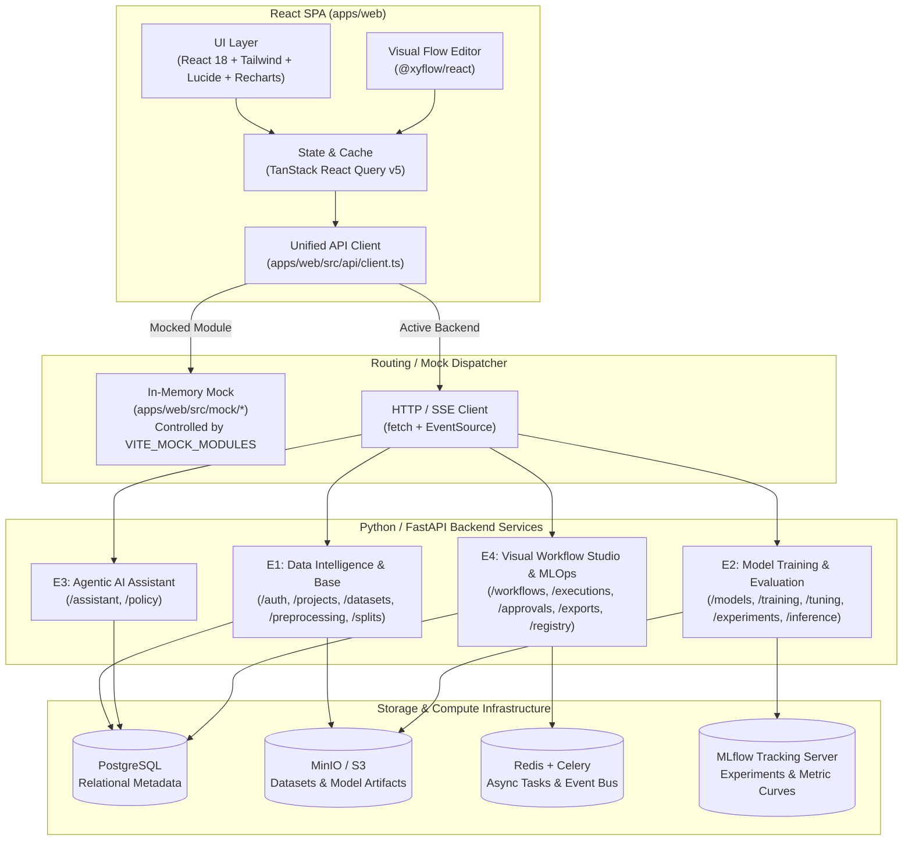
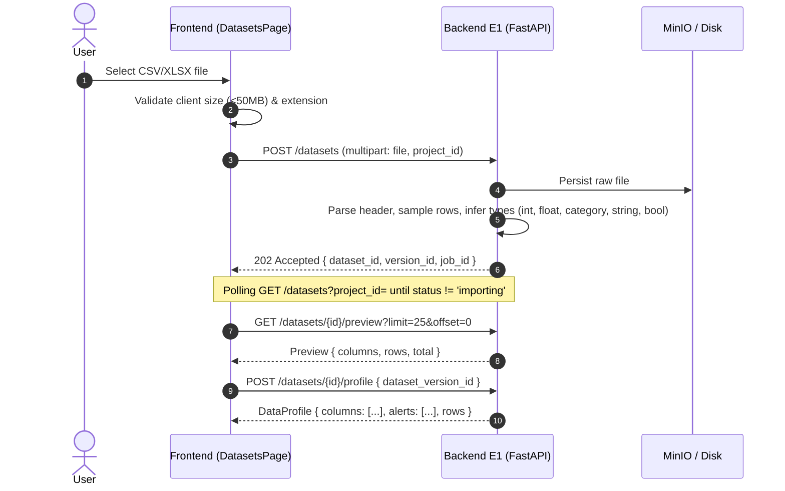
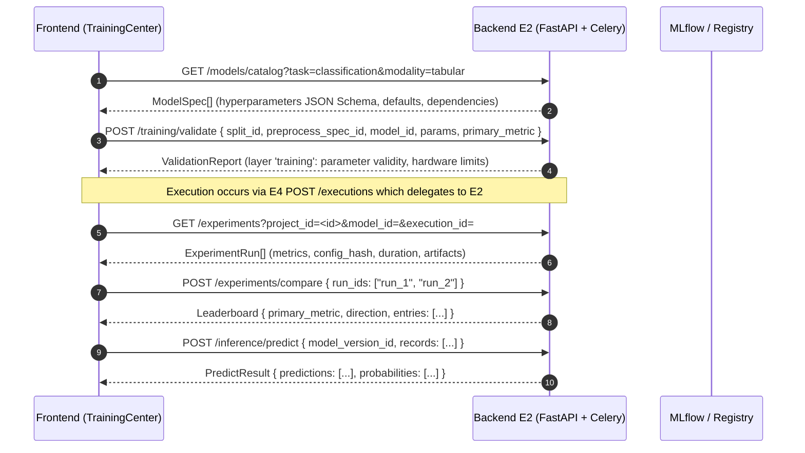
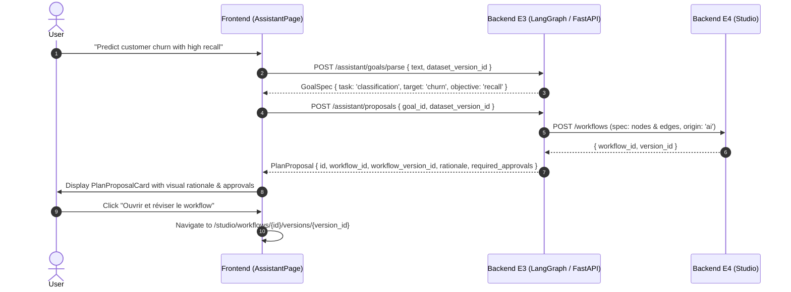
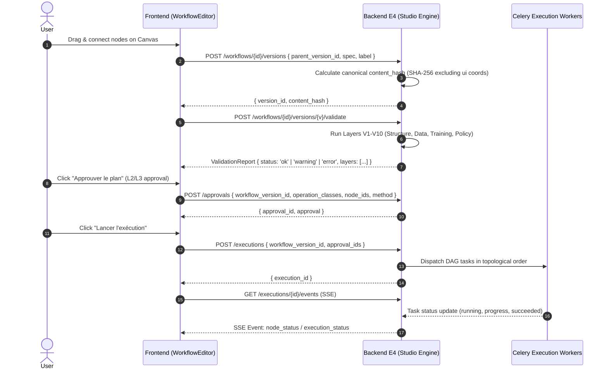
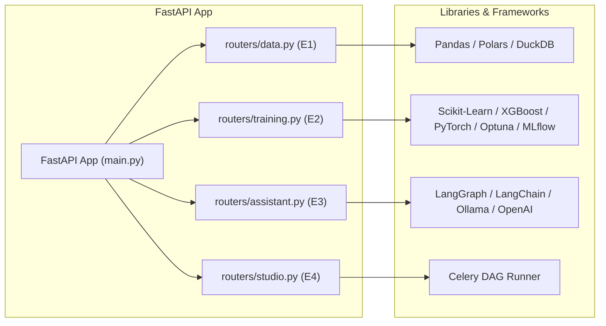

# AI Studio — Frontend & Backend Integration Architecture Specification

**Version:** 1.0.0
**Scope:** Complete interface contract and system architecture for implementing the AI Studio Python/FastAPI backend
**Target Audience:** Development team (E1 Data Intelligence, E2 Model Training, E3 Agentic AI, E4 Visual Workflow & MLOps)

---

## 1. Executive Summary & Architecture Overview

The AI Studio frontend is a modern single-page application (SPA) built with **React 18, TypeScript, Vite, Tailwind CSS, TanStack React Query v5, and React Flow (@xyflow/react)**.

The frontend serves as the **source of truth for interface requirements**. The system is decoupled from the backend via:

1. **Typed API Clients** (`apps/web/src/api/*.ts`) defining every expected endpoint, payload, and response.
2. **Shared JSON Schema Contracts** (`packages/contracts/`) specifying canonical models, the 8 workflow node types, policy matrix rules, and 10 validation layers (V1–V10).
3. **Selective In-Memory Mock Gateway** (`apps/web/src/mock/` + `VITE_MOCK_MODULES`) allowing individual backend modules to be connected and tested independently while mocking the rest.

### High-Level System Architecture




---

## 2. API Communication & Network Protocol

### 2.1 Base URL & Environment Configuration

The frontend reads two key environment variables from `apps/web/.env`:

- `VITE_API_BASE_URL`: Base address of the FastAPI backend (e.g. `http://localhost:8000`).
- `VITE_MOCK_MODULES`: Comma-separated list of modules handled by the mock (`data`, `training`, `assistant`, `studio`).
  - Removing `data` routes all `/auth`, `/projects`, `/datasets`, `/preprocessing`, `/splits` requests to `VITE_API_BASE_URL`.
  - All four modules can run behind a single unified FastAPI gateway on port 8000, or a reverse proxy.

### 2.2 Route Ownership Mapping

The frontend API client routes calls by path prefix:

| Module Code  | Module Name                         | Path Prefixes                                                                                          |
| ------------ | ----------------------------------- | ------------------------------------------------------------------------------------------------------ |
| **E1** | Data Intelligence & Core Foundation | `/auth/*`, `/projects/*`, `/datasets/*`, `/preprocessing/*`, `/splits/*`                     |
| **E2** | Model Training & Evaluation         | `/models/*`, `/training/*`, `/tuning/*`, `/experiments/*`, `/inference/*`                    |
| **E3** | Agentic AI Assistant                | `/assistant/*`, `/policy/*`                                                                        |
| **E4** | Visual Workflow Studio & MLOps      | `/catalog/*`, `/workflows/*`, `/executions/*`, `/approvals/*`, `/exports/*`, `/registry/*` |

### 2.3 Authentication & Session Management

- **Token Mechanism:** Bearer JWT in the HTTP header:
  ```http
  Authorization: Bearer <access_token>
  ```
- **Login Endpoint:** `POST /auth/login` returns:
  ```json
  {
    "access_token": "string",
    "refresh_token": "string",
    "user": {
      "id": "string",
      "name": "string",
      "email": "string"
    }
  }
  ```
- **Refresh Endpoint:** `POST /auth/refresh` returns `{ "access_token": "string" }`.

### 2.4 Standard Error Response Schema

When a request fails (`status >= 400`), the backend **must** return JSON matching the `ApiError` schema:

```json
{
  "code": "VALIDATION_FAILED",
  "message": "Human-readable error explanation",
  "details": { "field": "additional_context" },
  "request_id": "req_abc123"
}
```

### 2.5 Real-Time Execution Streaming (Server-Sent Events)

During workflow execution, the frontend establishes an SSE stream:

- **Endpoint:** `GET /executions/{execution_id}/events`
- **Headers:** `Accept: text/event-stream`, `Cache-Control: no-cache`
- **Supported Event Types:**
  1. `event: node_status`
     ```data
     data: {"id": 1, "type": "node_status", "execution_id": "exec_1", "node_id": "split_node", "status": "running", "ts": "2026-11-10T12:00:00Z"}
     ```
  2. `event: execution_status`
     ```data
     data: {"id": 2, "type": "execution_status", "execution_id": "exec_1", "status": "succeeded", "ts": "2026-11-10T12:01:00Z"}
     ```
- **Last-Event-Id:** Supported for resuming missed events on reconnection.

---

## 3. Module Specifications & Endpoints

### 3.1 Module E1: Data Intelligence & Foundation

E1 is responsible for authentication, project scoping, dataset ingestion, exploratory profiling (EDA), data transformations, and train/test splitting.



#### E1 Endpoints Table

| Method   | Path                                       | Request Body / Query                                            | Expected Response Body                                                       | Description                                                  |
| -------- | ------------------------------------------ | --------------------------------------------------------------- | ---------------------------------------------------------------------------- | ------------------------------------------------------------ |
| `POST` | `/auth/login`                            | `{ email, password }`                                         | `{ access_token, refresh_token, user }`                                    | Authenticates user                                           |
| `POST` | `/auth/refresh`                          | `{ refresh_token }`                                           | `{ access_token }`                                                         | Refreshes token                                              |
| `GET`  | `/projects`                              | —                                                              | `Project[]`                                                                | Returns user projects                                        |
| `POST` | `/projects`                              | `{ name }`                                                    | `Project & { project_id }`                                                 | Creates project                                              |
| `GET`  | `/datasets`                              | `?project_id=<id>`                                            | `DatasetRow[]`                                                             | Lists datasets with latest version status & stats            |
| `POST` | `/datasets`                              | `FormData(file, project_id)`                                  | `{ dataset_id, version_id, job_id }`                                       | Uploads and imports dataset (status: importing -> ready)     |
| `GET`  | `/datasets/{id}`                         | —                                                              | `{ id, name, project_id, versions: DatasetVersion[] }`                     | Retrieves dataset and version history                        |
| `GET`  | `/datasets/{id}/preview`                 | `?dataset_version_id=&limit=25&offset=0`                      | `Preview`                                                                  | Returns paginated sample records & schema                    |
| `POST` | `/datasets/{id}/profile`                 | `{ dataset_version_id }`                                      | `{ job_id }` or `DataProfile`                                            | Triggers or computes profiling (missing %, stats, histogram) |
| `GET`  | `/datasets/{id}/profile`                 | `?dataset_version_id=`                                        | `DataProfile \| (Job & { kind })`                                           | Reads profile or async calculation job status                |
| `GET`  | `/preprocessing/catalog`                 | —                                                              | `PreprocessTransform[]`                                                    | Catalog of transforms (`impute_median`, `onehot`, etc.)  |
| `POST` | `/preprocessing/recommendations`         | `{ dataset_version_id, target, task }`                        | `{ spec: { dataset_version_id, steps }, rule_ids, evidence_refs }`         | Automated heuristic recommendations                          |
| `POST` | `/preprocessing/validate`                | `{ dataset_version_id, spec: { steps }, target?, split_id? }` | `ValidationReport`                                                         | Layer 'data' checks (missing columns, type mismatch, leaks)  |
| `POST` | `/preprocessing/specs`                   | `{ dataset_version_id, spec: { steps } }`                     | `{ spec_id, version, content_hash }`                                       | Saves immutable transformation pipeline                      |
| `GET`  | `/preprocessing/specs`                   | `?dataset_version_id=`                                        | `PreprocessSpec[]`                                                         | Lists saved preprocessing specifications                     |
| `POST` | `/preprocessing/specs/{spec_id}/preview` | `{ split_id }`                                                | `{ columns_before, columns_after, missing_before, missing_after, sample }` | Displays impact preview of transforms                        |
| `POST` | `/splits`                                | `{ dataset_version_id, split_spec: SplitSpec }`               | `{ split_id, checksum }`                                                   | Executes train/val/test splitting                            |
| `GET`  | `/splits`                                | `?dataset_version_id=`                                        | `SplitVersion[]`                                                           | Lists splits for a dataset version                           |
| `GET`  | `/splits/{id}`                           | —                                                              | `SplitVersion`                                                             | Details of a split (sample counts, target distribution)      |

---

### 3.2 Module E2: Model Training & Evaluation

E2 implements the catalog of ML/DL algorithms (Scikit-Learn, XGBoost, LightGBM, PyTorch), hyperparameter tuning (Optuna), experiment tracking (MLflow), model registry, and real-time inference.



#### E2 Endpoints Table

| Method   | Path                      | Request Body / Query                                                            | Expected Response Body | Description                                                   |
| -------- | ------------------------- | ------------------------------------------------------------------------------- | ---------------------- | ------------------------------------------------------------- |
| `GET`  | `/models/catalog`       | `?task=&modality=tabular`                                                     | `CatalogModel[]`     | Available algorithms with hyperparameter schemas              |
| `GET`  | `/training/resources`   | —                                                                              | `TrainingResources`  | Hardware resource limits (CPU, GPU, concurrency, budget caps) |
| `POST` | `/training/validate`    | `{ split_id, preprocess_spec_id, model_id, params, primary_metric, budget? }` | `ValidationReport`   | Validates training configuration against split & hardware     |
| `GET`  | `/training/jobs`        | `?project_id=`                                                                | `TrainingJob[]`      | Lists training & tuning jobs                                  |
| `GET`  | `/training/jobs/{id}`   | —                                                                              | `TrainingJob`        | Current job status, progress (0.0 to 1.0), logs and metrics   |
| `GET`  | `/tuning/studies/{id}`  | —                                                                              | `Study`              | Optuna study details: trial values, best parameters           |
| `GET`  | `/experiments`          | `?project_id=&model_id=&execution_id=`                                        | `ExperimentRun[]`    | Lists experiment runs with metrics, hashes, and links         |
| `GET`  | `/experiments/{id}`     | —                                                                              | `ExperimentRun`      | Detailed run view: learning curves, artifacts, metrics        |
| `POST` | `/experiments/compare`  | `{ run_ids: string[] }`                                                       | `Leaderboard`        | Compares selected runs sorted by primary metric               |
| `GET`  | `/models/registry`      | `?project_id=`                                                                | `ModelVersion[]`     | Lists registered model versions                               |
| `GET`  | `/models/registry/{id}` | —                                                                              | `ModelDetail`        | Detailed model version and its originating `ExperimentRun`  |
| `POST` | `/inference/predict`    | `{ model_version_id, records?, dataset_version_id? }`                         | `PredictResult`      | Real-time batch or single prediction with class probabilities |

---

### 3.3 Module E3: Agentic AI Assistant

E3 is the intelligent orchestrator. It uses an LLM (LangGraph / Ollama / OpenAI / Anthropic) to converse with the user, parse natural language intent, generate structured workflow proposals (`PlanProposal`), and maintain the human-in-the-loop governance policy.

> [!IMPORTANT]
> **Strict Agentic Boundary:** The Assistant **NEVER** directly launches executions or trains models. It only creates draft workflow versions (`origin = 'ai'`) and proposals (`PlanProposal`). The user must explicitly approve and execute.



#### E3 Endpoints Table

| Method   | Path                          | Request Body / Query                      | Expected Response Body                      | Description                                                          |
| -------- | ----------------------------- | ----------------------------------------- | ------------------------------------------- | -------------------------------------------------------------------- |
| `GET`  | `/assistant/messages`       | `?project_id=`                          | `ChatMessage[]`                           | Retrieves conversation history                                       |
| `POST` | `/assistant/messages`       | `{ project_id, message, context_refs }` | `{ user_message, reply }`                 | Sends user query to LLM assistant                                    |
| `POST` | `/assistant/goals/parse`    | `{ text, dataset_version_id }`          | `{ goal: GoalSpec, questions, warnings }` | Extracts task, target, metric, and ambiguities from natural language |
| `POST` | `/assistant/proposals`      | `{ goal_id, dataset_version_id }`       | `PlanProposal`                            | Constructs optimal ML workflow proposal with rationale               |
| `GET`  | `/assistant/proposals/{id}` | —                                        | `PlanProposal`                            | Retrieves proposal details                                           |
| `POST` | `/assistant/explanations`   | `{ subject_ref }`                       | `Explanation`                             | Context-aware explanation of a dataset, run, or error                |
| `GET`  | `/assistant/mode`           | `?project_id=`                          | `{ project_id, mode: Mode }`              | Current governance mode (`auto`, `guided`, `expert`)           |
| `PUT`  | `/assistant/mode`           | `{ project_id, mode: Mode }`            | `{ project_id, mode: Mode }`              | Changes project governance mode                                      |
| `GET`  | `/assistant/audit`          | `?project_id=&action=&actor_type=`      | `AuditEvent[]`                            | Audit trail of all actions and AI proposals                          |
| `GET`  | `/policy/matrix`            | —                                        | `{ classes, modes, matrix }`              | Returns the governance permission matrix                             |

---

### 3.4 Module E4: Visual Workflow Studio & MLOps Engine

E4 is the central workflow engine. It manages the node-graph DAG editor, version immutability, canonical hashing, multi-layer validation, approvals, orchestrating Celery task execution, exporting reproducible bundles, and staging/production promotions.



#### The 8 Standard Node Types in the DAG

Every node in `spec.nodes` belongs to one of these 8 canonical node types:

| Node Type           | Owner | Operation Class | Input Ports                       | Output Ports                   | Purpose                               |
| ------------------- | ----- | --------------- | --------------------------------- | ------------------------------ | ------------------------------------- |
| `data.dataset`    | E1    | L0              | `[]`                            | `[dataset: Dataset]`         | Dataset version source                |
| `data.split`      | E1    | L1              | `[dataset: Dataset]`            | `[split: Split]`             | Train/Validation/Test splitter        |
| `data.preprocess` | E1    | L1              | `[split: Split]`                | `[spec: PreprocessSpecRef]`  | Cleans & transforms features          |
| `train.model`     | E2    | L2              | `[split, preprocess_spec]`      | `[run: ModelRun]`            | Trains single ML/DL model             |
| `train.tune`      | E2    | L2              | `[split, preprocess_spec]`      | `[leaderboard: Leaderboard]` | Optuna HPO study                      |
| `eval.compare`    | E2    | L0              | `[runs: ModelRun (multiple)]`   | `[leaderboard: Leaderboard]` | Compares multiple trained runs        |
| `eval.final_test` | E2    | L3              | `[run: ModelRun, split: Split]` | `[evaluated_run: ModelRun]`  | Final unbiased evaluation on test set |
| `model.register`  | E2    | L2              | `[run: ModelRun]`               | `[model: ModelVersion]`      | Registers model to catalog            |

#### E4 Endpoints Table

| Method   | Path                                        | Request Body / Query                                                              | Expected Response Body                            | Description                                                               |
| -------- | ------------------------------------------- | --------------------------------------------------------------------------------- | ------------------------------------------------- | ------------------------------------------------------------------------- |
| `GET`  | `/catalog/node-types`                     | —                                                                                | `{ catalog_version, node_types: NodeType[] }`   | Returns the 8 DAG node definitions                                        |
| `GET`  | `/catalog/templates`                      | —                                                                                | `Template[]`                                    | Pre-configured starter pipeline templates                                 |
| `GET`  | `/workflows`                              | `?project_id=`                                                                  | `WorkflowRow[]`                                 | Lists workflows in project with version counts                            |
| `POST` | `/workflows`                              | `{ project_id, name, spec, origin }`                                            | `{ workflow_id, version_id, content_hash }`     | Creates new workflow and initial version                                  |
| `POST` | `/workflows/from-template`                | `{ template_id, project_id, ...params }`                                        | `{ workflow_id, version_id, content_hash }`     | Instantiates workflow from template                                       |
| `GET`  | `/workflows/{id}`                         | —                                                                                | `{ workflow, versions: WorkflowVersionMeta[] }` | Workflow metadata and version history tree                                |
| `GET`  | `/workflows/{wf}/versions/{v}`            | —                                                                                | `WorkflowVersion`                               | Immutable version specification (nodes, edges)                            |
| `POST` | `/workflows/{wf}/versions`                | `{ parent_version_id, spec, label }`                                            | `{ version_id, content_hash, unchanged? }`      | Creates immutable version (deduplicates if hash matches)                  |
| `GET`  | `/workflows/{wf}/versions/{v}/diff`       | `?against=<version_id>`                                                         | `WorkflowDiff`                                  | Semantic DAG difference (nodes/edges added/removed/modified)              |
| `POST` | `/workflows/{wf}/versions/{v}/validate`   | —                                                                                | `ValidationReport`                              | Executes full multi-layer validation pipeline                             |
| `GET`  | `/workflows/{wf}/versions/{v}/validation` | —                                                                                | `ValidationReport`                              | Reads latest cached validation report                                     |
| `GET`  | `/approvals`                              | `?workflow_version_id=`                                                         | `Approval[]`                                    | Lists active approvals for a version                                      |
| `POST` | `/approvals`                              | `{ workflow_version_id, operation_classes, node_ids?, budget?, method, scope }` | `{ approval_id, approval }`                     | Records user approval for expensive/destructive actions                   |
| `POST` | `/approvals/{id}/revoke`                  | —                                                                                | `Approval`                                      | Revokes an active approval                                                |
| `POST` | `/executions`                             | `{ workflow_version_id, approval_ids, reuse_from_execution_id? }`               | `{ execution_id }`                              | **Only route to trigger execution**; checks policies and dispatches |
| `GET`  | `/executions`                             | `?workflow_id=&project_id=`                                                     | `Execution[]`                                   | Lists executions with node status and run timestamps                      |
| `GET`  | `/executions/{id}`                        | —                                                                                | `Execution`                                     | Real-time status of all `NodeRun` records                               |
| `POST` | `/executions/{id}/cancel`                 | —                                                                                | `Execution`                                     | Cancels running workflow execution                                        |
| `GET`  | `/executions/{id}/events`                 | —                                                                                | `text/event-stream` (SSE)                       | Real-time Server-Sent Events stream                                       |
| `POST` | `/exports`                                | `{ execution_id, include_data, approval_id? }`                                  | `{ export_id }`                                 | Generates reproducible standalone zip project                             |
| `GET`  | `/exports/{id}`                           | —                                                                                | `ExportManifest`                                | Manifest of export: code hashes, environment, dataset references          |
| `POST` | `/registry/promotions`                    | `{ model_version_id, alias, approval_id }`                                      | `PromotionRecord`                               | Promotes model to `staging` or `production` (requires L3 approval)    |
| `GET`  | `/registry/promotions`                    | `?model_name=`                                                                  | `PromotionRecord[]`                             | History of model promotions                                               |

---

## 4. Canonical Hash & Deterministic Serialization

To guarantee reproducibility and version immutability, `WorkflowVersion`, `PreprocessSpec`, and `ExportManifest` calculate a `content_hash`.

### Hash Rules:

1. **Excluded fields:** UI metadata (coordinates `ui: { x, y }`, comments, visual-only labels) are excluded from the hash so moving a node on the canvas does not invalidate an approved version.
2. **Key Ordering:** All dictionary keys must be sorted lexicographically before serialization.
3. **Algorithm:** SHA-256 formatted as `sha256:<lowercase_hex>`.
4. **Implementation Reference:** See [`packages/contracts/src/hash.ts`](file:///d:/EMSI/5emme/AUTOML/packages/contracts/src/hash.ts).

---

## 5. Resolution of Contract Gaps (from `CONTRACT_GAPS.md`)

When implementing the backend, follow these official decisions:

| #           | Gap / Discrepancy                                        | Backend Implementation Rule                                                                                                                                    |
| ----------- | -------------------------------------------------------- | -------------------------------------------------------------------------------------------------------------------------------------------------------------- |
| **1** | `GET /datasets?project_id=` missing in doc             | **Must implement:** E1 returns `DatasetRow[]` with columns `id`, `name`, `latest_version_id`, `rows`, `columns`, `status`, `created_at`. |
| **2** | `GET /splits` and `GET /preprocessing/specs` missing | **Must implement:** E1 accepts `?dataset_version_id=` to filter by dataset version.                                                                    |
| **3** | `GET /training/jobs?project_id=` missing               | **Must implement:** E2 lists recent training jobs for the Training Center.                                                                               |
| **4** | `GET /catalog/templates` missing                       | **Must implement:** E4 returns list of 3-4 standard starter templates (`tabular_classification`, `optuna_tuning`, etc.).                             |
| **5** | Profile result polymorphism                              | **Must clarify:** `GET /datasets/{id}/profile` returns an explicit `status: 'computing' \| 'ready' \| 'failed'`.                                       |
| **6** | `NodeRun` progress and timestamps                      | **Must include:** E4 `NodeRun` must have `progress` (float 0-1), `started_at` (ISO timestamp), `finished_at` (ISO timestamp).                    |
| **7** | `POST /exports` approval link                          | **Must support:** When `include_data = true`, request body accepts `approval_id: string` verifying L3 approval.                                      |
| **8** | Model Origin Link                                        | `ModelVersion` and `ExperimentRun` must store `workflow_version_id` and `execution_id` to enable auditability and promotion verification.              |

---

## 6. Recommended Backend Technology Stack & Architecture



### Recommended Directory Structure for the Backend

```text
backend/
├── app/
│   ├── main.py                  # FastAPI application entrypoint with CORS & exception handlers
│   ├── config.py                # Environment variables (DB_URL, MINIO_URL, REDIS_URL, LLM_API_KEY)
│   ├── auth.py                  # JWT authentication, password hashing, and user dependencies
│   ├── database.py              # SQLAlchemy / SQLModel database session setup
│   ├── models/                  # Database tables (PostgreSQL models)
│   │   ├── project.py
│   │   ├── dataset.py
│   │   ├── experiment.py
│   │   ├── workflow.py
│   │   └── approval.py
│   ├── schemas/                 # Pydantic schemas generated from packages/contracts/
│   │   ├── data.py
│   │   ├── training.py
│   │   ├── assistant.py
│   │   └── studio.py
│   ├── routers/
│   │   ├── auth.py              # /auth endpoints (E1)
│   │   ├── projects.py          # /projects endpoints (E1)
│   │   ├── datasets.py          # /datasets, /preprocessing, /splits (E1)
│   │   ├── training.py          # /models, /training, /tuning, /experiments, /inference (E2)
│   │   ├── assistant.py         # /assistant, /policy (E3)
│   │   └── studio.py            # /workflows, /executions, /approvals, /exports, /registry (E4)
│   ├── workers/                 # Celery asynchronous worker tasks
│   │   ├── celery_app.py
│   │   ├── data_tasks.py        # Profiling, splitting, preprocessing execution
│   │   ├── training_tasks.py    # Model fitting, hyperparameter tuning, evaluation
│   │   └── studio_tasks.py      # DAG execution engine & SSE dispatcher
│   └── services/
│       ├── storage.py           # MinIO S3 object storage client
│       ├── profiling.py         # Automated statistical EDA
│       ├── ml_engine.py         # Model training & Optuna runners
│       └── llm_agent.py         # LangGraph assistant agent & goal parser
├── requirements.txt
└── Dockerfile
```

---

## 7. Step-by-Step Backend Connection Guide

When a developer is ready to connect their backend module to the frontend:

1. **Start the Backend:**
   Run the FastAPI server on port 8000:

   ```bash
   uvicorn app.main:app --host 0.0.0.0 --port 8000 --reload
   ```
2. **Configure CORS:**
   In FastAPI, ensure CORS is enabled for the frontend:

   ```python
   from fastapi.middleware.cors import CORSMiddleware

   app.add_middleware(
       CORSMiddleware,
       allow_origins=["http://localhost:5173", "http://localhost:8080"],
       allow_credentials=True,
       allow_methods=["*"],
       allow_headers=["*"],
   )
   ```
3. **Update Frontend Environment:**
   In `apps/web/.env`:

   - To connect **Developer 1 (Data)**:
     ```env
     VITE_MOCK_MODULES=training,assistant,studio
     VITE_API_BASE_URL=http://localhost:8000
     ```
   - To connect **Developer 1 & 2**:
     ```env
     VITE_MOCK_MODULES=assistant,studio
     VITE_API_BASE_URL=http://localhost:8000
     ```
   - To run **Full Real Backend**:
     ```env
     VITE_MOCK_MODULES=
     VITE_API_BASE_URL=http://localhost:8000
     ```
4. **Test in the Browser:**
   Open `http://localhost:5173` — network requests for connected modules will now hit your FastAPI server directly, visible in your browser's DevTools Network tab.
